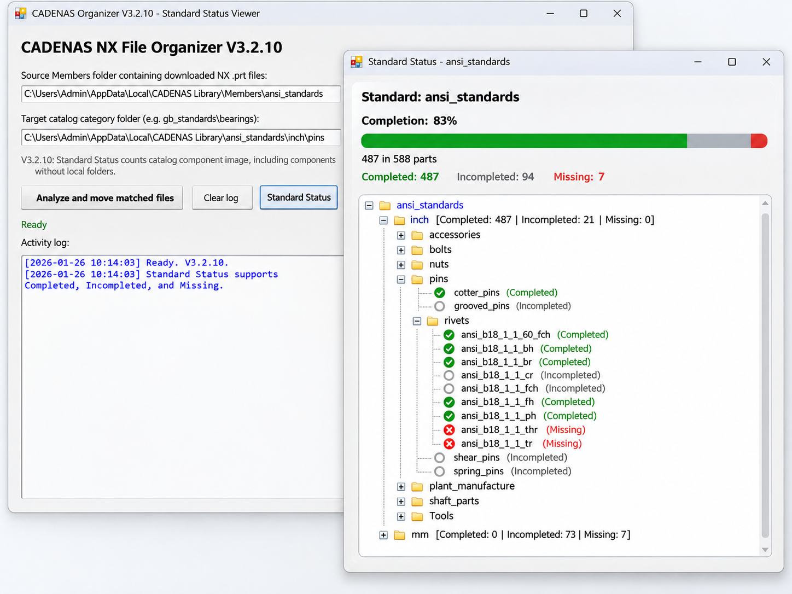
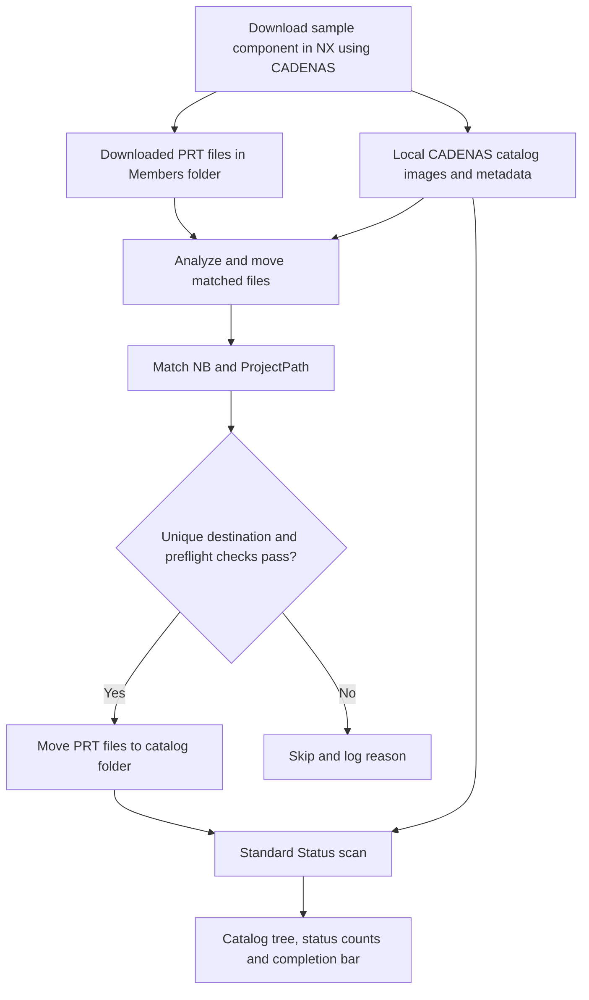

# CADENAS NX File Organizer


A Windows desktop utility for organizing sample components downloaded from the **CADENAS library in Siemens NX** and monitoring the completion of local standard component catalogs.

The project helps engineers build and maintain a structured NX standard parts library without manually locating the destination folder for each downloaded `.prt` file. The organizer moves matched files into their corresponding catalog folders and provides a visual overview of downloaded, incomplete and missing components.

## Application screenshot



*Illustrative reconstruction of the V3.2.10 interface, based on application screenshots. The example shows the catalog tree, status counters and three-color segmented completion bar; counts are illustrative, not a live catalog scan.*

## Features

### Automatic NX component organization

- Reads CADENAS `PartInfo` metadata, including the `NB` and `ProjectPath` fields.
- Matches downloaded Siemens NX `.prt` files to their intended catalog folders.
- Resolves nested destination paths from the catalog project path.
- Groups split component files with `_PARTn` or `-n` suffixes with their base component.
- Checks for ambiguous matches, existing destination files and inaccessible source files before moving a group.
- Records moved files, skipped groups and errors in the activity log.

### Standard Status Viewer

The **Standard Status** button opens a dedicated window showing the overall status of the selected standard library, not just the currently selected target category.

- Recursively scans the locally available catalog image inventory.
- Separates category items from component items.
- Displays all identified components, including those without a local component folder.
- Calculates total parts, status counts and completion percentage.
- Displays a resizable, three-color segmented progress bar.
- Preserves the catalog hierarchy and automatically expands the selected target category when it is found in the tree.
- Performs a read-only catalog scan without moving, creating or deleting component files.

## Component status logic

Catalog preview images are grouped by their base filename within each directory, ignoring the image extension and filename case. The image inventory is used instead of simply counting existing folders.

| Item | Preview images | Matching folder | NX `.prt` file inside folder | Counted as a part |
| --- | ---: | :---: | :---: | :---: |
| Category | 2 | Yes | — | No |
| 🟢 Completed | 1 | Yes | Yes | Yes |
| ⚪ Incompleted | 1 | Yes | No | Yes |
| 🔴 Missing | 1 | No | — | Yes |

Categories are scanned recursively but are not included in the component count. A component is counted once per catalog location, regardless of the number of NX files it contains.

Structural folders without matching preview images can also be traversed to discover components. Preview groups containing more than two images are treated as categories and reported in the activity log.

The status check does not require `.ps3`, component TXT, `PartInfo.txt` or `defaultTable.txt` files. This supports both the older NX 1855 download structure and the NX 2506 structure where PS3 files may be absent. `PartInfo` metadata is still required for automatic file matching and moving.

### Completion calculation

```text
Total parts = Completed + Incompleted + Missing
Completion (%) = Completed / Total parts × 100
```

For example, a catalog containing 100 component items, of which 65 are completed, 20 are incompleted and 15 are missing, has a completion rate of 65%.

| Status | Count | Progress bar |
| --- | ---: | --- |
| 🟢 Completed | 65 | Green |
| ⚪ Incompleted | 20 | Gray |
| 🔴 Missing | 15 | Red |
| **Total** | **100** | **Completion: 65%** |

The progress bar displays the proportion of all three statuses. The completion percentage is rounded to a whole number; when no components are found, the viewer displays 0%.

> [!NOTE]
> The total represents the locally available catalog preview inventory, not a live count of the entire CADENAS online library. Catalog items whose preview images have not been fetched locally cannot be counted. A component marked Completed has at least one direct `.prt` file in its corresponding folder; this does not validate NX geometry, assembly completeness or every size variant.

## System requirements

- Microsoft Windows with Windows PowerShell and .NET Framework Windows Forms / System.Drawing support (Windows PowerShell 5.1 is the intended runtime).
- Siemens NX with access to the CADENAS component library for downloading sample components.
- Read/write access to the relevant local CADENAS folders and the user's Documents folder.

The organizer has been used with Siemens NX 1855 and NX 2506. No separate GUI framework, database or additional PowerShell modules are required. The organizer itself works with local files; CADENAS online access is needed separately when fetching catalog data or downloading components.

## Repository structure

```text
CADENAS/
├── _Organizer/
│   ├── CadenasOrganizer.ps1
│   └── Start_CADENAS_Organizer.bat
├── gb_standards/    # Existing GB standard library content
├── screenshot.png
└── README.md
```

The V3.2.10 organizer distribution contains the following two files. Keep them in the same directory:

| File | Description |
| --- | --- |
| `CadenasOrganizer.ps1` | Main PowerShell application and Windows Forms interface |
| `Start_CADENAS_Organizer.bat` | Windows batch launcher |

## Getting started

1. Download or clone this repository from [GitHub](https://github.com/erik-john/CADENAS).
2. Open the `_Organizer` directory and locate the organizer script and batch launcher.
3. Run `Start_CADENAS_Organizer.bat` to launch the application. Alternatively, open PowerShell in the directory containing the two files and run:

   ```powershell
   .\Start_CADENAS_Organizer.bat
   ```

4. Select the **Source Members folder** for the relevant standard and the **Target catalog category folder**.
5. Use **Analyze and move matched files** to organize downloaded NX files, or **Standard Status** to inspect library completion.

The launcher uses Windows PowerShell with `-NoProfile`, `-STA` and a process-level `-ExecutionPolicy Bypass`. Review the script before running it and follow your organization's PowerShell security policies.

### Example local CADENAS paths

```text
%LOCALAPPDATA%\CADENAS Library\
├── Members\
│   └── gb_standards\             # Source: downloaded NX files
└── gb_standards\                 # Catalog root
    └── bearings\                 # Example target category
```

| Application field | Example value |
| --- | --- |
| Source Members folder | `%LOCALAPPDATA%\CADENAS Library\Members\gb_standards` |
| Target catalog category folder | `%LOCALAPPDATA%\CADENAS Library\gb_standards\bearings` |

These are illustrative locations. Use **Browse...** to select the actual directories on your computer. Other standards, such as `ansi_standards`, can be selected using the same folder structure. Select the standard folder directly under `Members`, not `Members` itself.

## Usage workflow



### Organize downloaded files

Download the desired sample components in Siemens NX, select their source standard and destination category, and click **Analyze and move matched files**. The organizer uses metadata under the selected target category to find destinations for `.prt` files directly inside the selected source directory.

The action moves files immediately after matching and preflight checks; it is not a dry-run or copy operation. Existing destination files are not overwritten. Check the activity log for any files or groups that were skipped. Keep backups of important library data before performing bulk file operations.

### Check standard library completion

Select the source standard, then click **Standard Status**. The organizer locates the corresponding catalog outside `Members` and scans the entire locally available standard. The selected target category is used to focus the tree, not to restrict the completion calculation.

Review the green, gray and red component indicators and the summary counts. After downloading or organizing additional components, reopen the Standard Status Viewer to refresh the results.

## Configuration and logging

The selected source and target paths are retained between sessions. The configuration and activity log are stored under the user profile:

```text
%USERPROFILE%\Documents\CADENAS_Organizer\
├── config.json
└── Organizer_Log.txt
```

**Clear log** clears the visible activity log in the main window. The persistent log file is retained for troubleshooting.

## Troubleshooting

| Symptom | Recommended check |
| --- | --- |
| No files moved | Check the selected source folder, target category and `PartInfo` metadata. |
| A component is skipped | Review the activity log for unmatched names, ambiguous destinations, existing files or locked source files. |
| A component is Incompleted | Check whether its corresponding folder contains a direct `.prt` file. |
| A component is Missing | Download the sample in NX and ensure the component folder is created. |
| Total parts is lower than expected | Check whether all catalog preview images have been fetched locally. |
| Standard Status scan fails | Check the source standard path and directory access; review the error location and call stack in the log. |

## Current version

**V3.2.10**

The current organizer combines metadata-driven NX file organization, image-based component inventory, three-state classification, catalog tree navigation and a segmented completion bar.

## Acknowledgments

This is an independent organizer utility for workflows involving CADENAS standard component catalogs and Siemens NX. It is not an official product of CADENAS or Siemens. CADENAS, Siemens NX and associated product names belong to their respective owners. Catalog data and CAD models remain subject to their applicable provider and manufacturer terms.
